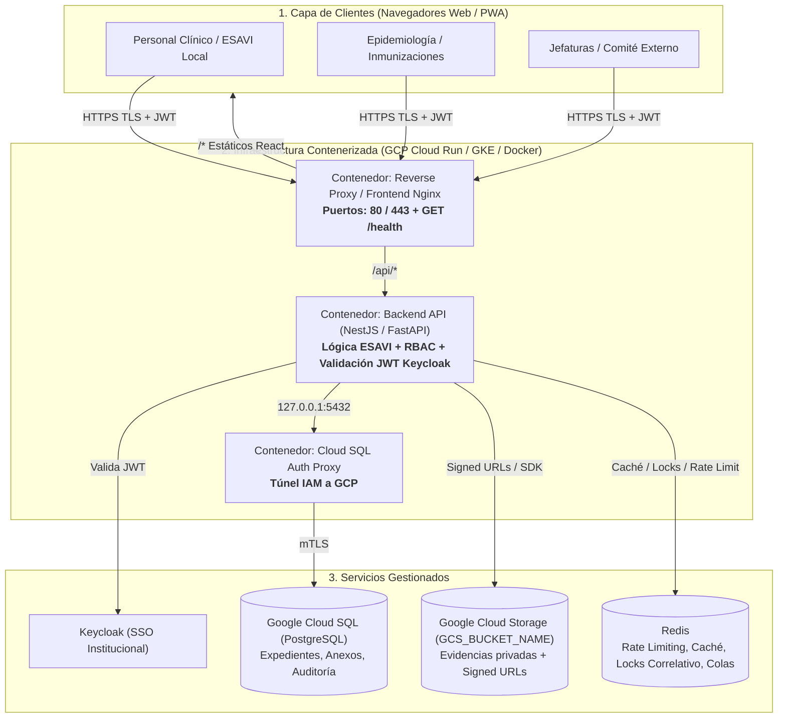
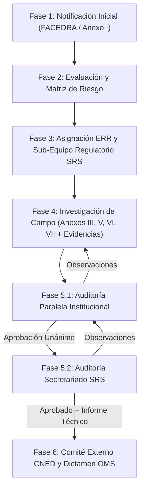

# Modelo de Datos y Arquitectura de Persistencia

> **Fuente:** Consolidación de [`diagrama-esavi.mmd`](../../diagrama-esavi.mmd) y [`arquitectura-docker-cloudsql.mmd`](../../arquitectura-docker-cloudsql.mmd) bajo el estándar SDD (`/specs/data`).

---

## 1. Arquitectura de Contenedores y Servicios GCP

---

## 2. Flujo Funcional del Caso ESAVI

---

## 3. Diccionario de Entidades Principales (Transición Firestore -> PostgreSQL)

| Entidad / Colección | Identificador Primario | Campos Clave y Propósito |
| :--- | :--- | :--- |
| **`casos` (`expedientes`)** | `id_caso` (`ESAVI-YYYY-XXX`) | Metadatos de trazabilidad, `id_creador`, `establecimiento_notificador`, `id_establecimiento`, `riesgo`, `estado_flujo`, `datos_fase1_json`, `medicamentos_concomitantes_json`, `equipo_err_json`, `equipo_regulatorio_json`, `dictamen_data`, banderas `anexoIII/V/VI/VII`, `archivosAdjuntos`. |
| **`ANEXO_III_LOGISTICA`** | `id_caso` | Requerimientos logísticos, transporte, bioseguridad y cadena de custodia previo al despliegue de campo. |
| **`ANEXO_V_PUESTO`** | `id_caso` | Evaluación de cadena de frío, manipulacion de diluyentes/jeringas, otros vacunados con mismo lote y entrevista al vacunador. |
| **`ANEXO_VI_DOMICILIO`** | `id_caso` | Condiciones de vivienda, búsqueda comunitaria de casos similares y entrevista familiar domiciliaria. |
| **`ANEXO_VII_CLINICO`** | `id_caso` | Anamnesis detallada, cronología de eventos clínicos, paraclínicos, hallazgos de autopsia, datos obstétricos y miembros del ERR. |
| **`MATRIZ_RIESGO`** | `id_caso` | Criterios de gravedad y ponderación de riesgo (`Bajo`, `Moderado`, `Alto`, `Crítico`). |
| **`ASIGNACIONES_ERR`** | `id_caso` | Miembros locales, auditores institucionales, referentes SRS y apoyos (`VER` / `LLENAR`). |
| **`AUDITORIAS_CALIDAD`** | `id_auditoria` | Evaluaciones parciales por anexo en Fase 5.1 (`aprobado` / `observado`) y resoluciones de Fase 5.2. |
| **`historial_cambios`** | `id_log` | Bitácora inmutable de auditoría (`fecha`, `usuario`, `rol`, `accion`, `id_caso`). |
| **`usuarios`** | `email` | Perfil institucional, rol RBAC, establecimiento asignado (`id_establecimiento`), `institucionMacro`, estado `activo`. |
| **`establecimientos`** | `id` | Catálogo oficial de USSF / Hospitales MINSAL e ISSS, departamento, municipio y SIBASI. |

---

## 4. Repositorio Digital de Evidencias (5 Categorías Oficiales)

Las evidencias adjuntas en el Anexo I se clasifican obligatoriamente en cinco particiones lógicas:
1. `clinica`: Historia clínica, epicrisis, exámenes de laboratorio, necropsia/autopsia.
2. `pni`: Carné de vacunación, registros del puesto, control de temperatura y cadena de frío.
3. `epidemiologica`: Fichas de investigación comunitaria, mapas epidemiológicos, entrevistas de campo.
4. `general`: Documento de identidad (DUI/pasaporte) y documentación administrativa.
5. `regulatorio` (`[REGULATORIO]`): Habilitado exclusivamente para casos **Alto/Crítico**; escritura reservada al **Secretariado Analista** / **Coordinador**.

---

## 5. Caché Offline Local (`IndexedDB` / Dexie: `esavi_offline_db`)

| Tabla Local | Propósito | Regla de Seguridad en `logout()` |
| :--- | :--- | :--- |
| `casosCache` | Copia de solo lectura para consulta sin internet. | **Se purga por completo** al cerrar sesión. |
| `anexosLocales` | Borradores (`BORRADOR`) y envíos en cola (`PENDIENTE_SYNC`). | Se eliminan registros `SINCRONIZADO`; se preservan borradores/pendientes sin sincronizar. |
| `evidenciasLocales` | Archivos binarios (`Blob`) capturados en campo offline. | Se eliminan registros `SINCRONIZADO`; se preservan pendientes de subir. |
| `colaSincronizacion` | Outbox priorizado (`1: Archivos`, `2: Anexos`). | Se conserva intacto hasta completar sincronización exitosa. |
